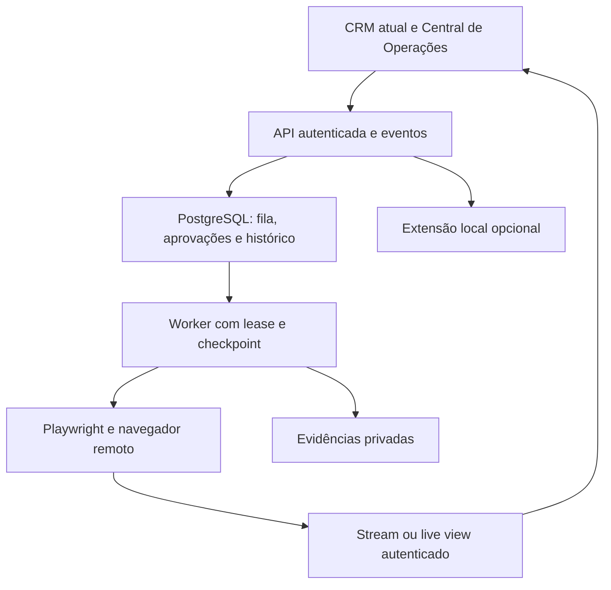

# 02 — Arquitetura recomendada e responsabilidades

Tudo neste documento é proposta futura. Nenhum serviço foi contratado, provisionado ou ligado à produção.

## Decisão

Recomendo **arquitetura híbrida C**, com **operador remoto visível como principal**, persistência central e a extensão atual preservada como adaptador local opcional. Backend e fila são únicos; remoto e extensão não mantêm filas independentes de envio.

Stack inicial proposta: frontend HTML/JS existente; API e worker TypeScript/Node.js em serviço persistente; PostgreSQL com fila transacional; navegador Chromium/Playwright gerenciado, inicialmente Browserbase; armazenamento privado compatível com S3 para evidências. SSE para eventos, endpoints HTTP autenticados para comandos. Um único worker de envio por campanha no início. Não é necessário LLM para mapear, preencher ou executar os comandos fixos do usuário.

Browserbase é a opção recomendada para reduzir o trabalho inicial de transmissão e sessões, **condicionada a uma prova de acesso permitido ao Sotheby’s e de visualização autenticada dentro do CRM**. Um contrato comercial de navegador não garante acesso ao site nem substitui suas regras. Se houver bloqueio persistente, interromper o adaptador remoto e registrar a limitação. A extensão pode continuar apenas em acesso normal permitido no navegador do usuário; não usá-la como ponte para contornar uma recusa do site.

## A, B e C

| Critério | A — Remoto | B — Extensão local | C — Híbrido recomendado |
|---|---|---|---|
| Sessão visível no CRM | Stream/live view do navegador remoto | Aba local visível; espelhamento exige captura/permissão adicional | Stream remoto principal; modo local explicitamente identificado |
| PC desligado | Worker pode continuar | Não continua | Remoto continua conforme autorização |
| Compatibilidade atual | Reaproveita regras, precisa adaptador | Mais próxima do código atual | Mantém investimento e separa mecanismo de execução |
| Persistência | Banco + sessões remotas | Chrome local; exige sincronização central para evoluir | Banco central como verdade comum |
| Trabalhos longos | Checkpoints e rotação de sessões | Limites do Chrome, suspensão de MV3 e fechamento de aba | Retomada coordenada e backend independente da aba |
| Custo incremental | Navegador, worker, banco, evidências | Menor infraestrutura, maior dependência operacional local | Custo remoto inicial + manutenção de dois adaptadores |
| Risco principal | Acesso ao canal ainda não homologado | Usuário precisa manter Chrome e extensão corretos | Evitar duas execuções do mesmo contato |

Playwright sozinho não fornece transmissão web. É controlador do navegador. A observação exige serviço de live view, screencast ou uma pilha gráfica (por exemplo, Chromium em VM com display e gateway VNC web). Não carregar a página do Sotheby’s diretamente num iframe do CRM esperando controlar seu DOM; mesma origem, CSP e frames impedem essa suposição.

Uma VM própria com navegador e gateway visual é alternativa ao provedor, mas acrescenta isolamento, atualizações do Chromium, certificados, autenticação do stream, gravação e controle de sessão. Não é a primeira escolha para esta entrega.

## Topologia proposta

A imagem mostrada precisa vir da mesma sessionId/pageId do job em execução. A Central continua em **`https://ai-property-crm.flaviocostaestevam.chatgpt.site/#operacoes`**. Essa rota por hash é compatível com o HTML estático atual. Uma rota `/operacoes` só deve substituir o hash após configurar e testar fallback/roteamento no Sites.

## O que é possível no GPT-Sites

- Continuar o mesmo Site, layout, abas, bundle e URL.
- Criar a Central em HTML/JS, os controles, a revisão das mensagens e os estados reais recebidos da API.
- Renderizar transmissão remota ou frames autenticados, com horário e estado da conexão.
- Integrar API externa HTTPS e eventos, preservando exportação e histórico local.
- Evoluir para camada servidor suportada pelo Sites se houver necessidade concreta: a documentação do plugin prevê Worker e bindings D1/R2. Hoje esses recursos **não estão declarados** neste projeto. Não presumir que PostgreSQL, filas externas ou Chromium já estão provisionados.

O runtime Worker documentado opera em isolates limitados; não é um processo Linux persistente no qual iniciar Chromium como subprocesso. Um serviço remoto de navegador pode ser chamado por API, mas executar jobs longos exige orquestração persistente. Capacidades gerais da Cloudflare, como Browser Run/Queues, não são automaticamente bindings disponíveis neste projeto Sites. Confirmar suporte do plugin antes de escolhê-las.

## O que o Codex deverá desenvolver

Codex pode editar tanto o frontend Sites quanto backend, worker e extensão. A separação é de runtime e responsabilidade, não de uma exclusividade entre ferramentas.

| Componente proposto | Hospedagem | Trabalho necessário |
|---|---|---|
| Central de Operações | Mesmo Site | Novas seções, adaptador de API, visualização e revisões |
| API e autenticação do operador | Serviço externo inicialmente | Identidade do proprietário, autorização, comandos idempotentes, eventos |
| Fila e histórico central | PostgreSQL | Schema, migração, leases, eventos e aprovações versionadas |
| Worker Playwright | Serviço persistente | Executar passos, pausar, renovar lease, verificar resultados |
| Navegador remoto | Browserbase ou provedor aprovado | Sessão, contexto persistente, live view, limite e encerramento |
| Evidências | Storage privado | Screenshots, respostas sanitizadas, hashes e retenção |
| Adaptador de extensão | Chrome do usuário, opcional | Pareamento e sincronização com o mesmo backend |

## Contratos e dados futuros

Entidades propostas, ainda não existentes: `workspaces`, `agents`, `directory_cursors`, `campaigns`, `message_versions`, `approvals`, `jobs`, `job_items`, `send_attempts`, `events`, `browser_sessions`, `artifacts`, `import_batches`, `suppression_entries`.

- `agents`: UUID, workspace_id, external_profile_id, canonical_url, number, name, source_url, discovery_ordinal, sort_direction, timestamps. UNIQUE(workspace_id, external_profile_id) e UNIQUE(workspace_id, number).
- `directory_cursors`: diretório, ordenação validada, URL e número da página, posição e ID de próximo/último corretor, geração do percurso, versão da lista quando observável.
- `message_versions`: versão imutável, destinatário/URL, remetente, texto, hashes, origem das informações e snapshot da campanha. Modificar cria outra versão.
- `approvals`: ator ou política autorizada, modo, conteúdo/hash aprovado, destinatário, sender_hash, campaign_version, validade, revogação e versão de política.
- `job_items`: ordem fixa e estado operacional; lease_owner, lease_until, fencing_token; reserva transacional de trabalho. Não usar a ordem da renderização como fila.
- `send_attempts`: attempt_id, idempotency_key, estado antes/depois, disparo do clique, recibo/evidência, resultado conhecido ou desconhecido.
- `events`: append-only, sequência crescente por workspace, actor, item, timestamp servidor, tipo e payload sanitizado. SSE retoma pelo último event_id.
- `artifacts`: objeto privado, SHA-256, categoria, session/page IDs, criado em e expiração; sem URL permanente pública.
- `import_batches`: hash do backup, resumo de contagem, mapeamento de IDs e reconciliação, sem substituir base por efeito colateral.

Fila inicial em PostgreSQL: uma transação reserva o próximo item elegível em ordem, com lease e fencing; `FOR UPDATE SKIP LOCKED` é uma possibilidade documentada, mas para ordem estrita manter apenas um consumidor de envio por campanha. Redis não é exigência inicial. Se entrar BullMQ, o banco permanece a verdade e outbox/inbox idempotente coordena a publicação. Evitar duas verdades.

## API proposta

Prefixo externo `/v1`; `workspace` sempre resolvido pela sessão autenticada.

| Operação | Contrato |
|---|---|
| POST `/imports` | Backup versionado, idempotency-key; devolve contagens/conflitos |
| POST `/commands` | map/prepare/start/pause/resume/stop, limite, campanha, requestId |
| GET `/jobs/:id` | Estado, atual, fila, cursor, contadores e última ação |
| GET `/events` | SSE autenticado com reconexão/último ID; fetch streaming se token em memória |
| POST `/messages/:id/versions` | Editar como nova versão, invalidando aprovação anterior |
| POST `/approvals` | Aprovar versão exata; individual ou snapshot do lote |
| POST `/approvals/:id/revoke` | Revogar antes do envio; persistência e evento |
| GET `/sessions/:id/view` | Sessão autorizada, expiração, página e método de visualização |
| POST `/sessions/:id/takeover` | Pausar e obter lease manual exclusivo |
| POST `/sessions/:id/release` | Revalidar campos/versão antes de devolver ao worker |

Não são endpoints já publicados. Falhas e comandos devem ter códigos estruturados; não depender de textos da interface para controle de estado.

## Sessão, visualização e duração

O Browserbase documenta live view embutível e interativa, contextos persistentes, keepAlive em planos pagos e duração máxima de sessão de 6h. Não manter um único navegador por dias: dividir lotes em unidades com checkpoint, renovar sessão antes do limite e liberar recursos durante esperas longas. Contexto de navegador não substitui o checkpoint de negócio no banco.

Visualização principal pode usar live view do provedor. Para observação estritamente sem controle, preferir frames do navegador a cada 1–2 segundos servidos pela API autenticada, ou um modo somente leitura realmente imposto pelo provedor. **`pointer-events:none` é apresentação, não autorização.** O frontend não deve receber CDP connectUrl com API key, nem um token de controle permanente disfarçado de stream de leitura.

Tomada de controle manual concede lease exclusivo, suspende ações do worker e só libera a view interativa ao ator autorizado. Após devolução, comparar destinatário e hash de todos os campos com a aprovação. Modificação manual do formulário não confirma envio nem mantém automaticamente a aprovação.

## Autenticação e privacidade da Central

Preservar o endereço público do CRM não exige tornar dados/controle remotos públicos. O shell pode continuar público; rotas de dados e sessão operacional precisam de autenticação do proprietário, ou pareamento seguro equivalente. Proposta: sessão autenticada de proprietário no backend, com credencial curta e revogável. Método de entrada será definido na implementação; não adicionar login ou segredo estático sem comunicar essa mudança de comportamento.

Nunca usar API key do provedor no JS público, query string de eventos ou localStorage. Segredos no servidor; credenciais curtas do usuário em sessão protegida. Autorizar cada ação por workspace; CORS na origem exata não substitui autenticação. Live view é acesso à sessão: não gravar links de controle em logs públicos. Em modo autônomo, tela desconectada não cancela uma campanha autorizada, mas toda sessão e ação continua auditada.

## Configuração proposta

| Variável | Local | Uso |
|---|---|---|
| `OPERATOR_API_BASE_URL` | Frontend, pública | Origem HTTPS da API; não é chave |
| `DATABASE_URL` | API/worker, secreta | PostgreSQL |
| `BROWSERBASE_API_KEY`, `BROWSERBASE_PROJECT_ID` | Worker, secreta/configuração | Criar e controlar sessões |
| `SESSION_SIGNING_KEY` | API, secreta | Sessões operacionais curtas |
| `SESSION_ENCRYPTION_KEY` | API/worker, secreta | Estado sensível persistido |
| `ALLOWED_CRM_ORIGIN` | API | Origem exata do CRM |
| `ARTIFACT_BUCKET`, `ARTIFACT_ENDPOINT` | Worker/API | Destino privado de evidências |
| `ARTIFACT_ACCESS_KEY`, `ARTIFACT_SECRET_KEY` | Worker/API, secretas | Credenciais do storage |
| `OPERATOR_SEND_ENABLED=false` | Worker | Gate de envio global inicialmente desligado |
| `MAX_BROWSER_CONCURRENCY=1` | Worker | Execução inicial sequencial |
| `ARTIFACT_RETENTION_DAYS` | Backend | Política explícita de retenção |
| `LLM_API_KEY` | Worker, opcional e secreta | Somente se personalização futura for aprovada |

Não existem valores preenchidos ou provedores provisionados nesta entrega. Adicionar `.env.example` sem segredos e validação de configuração no futuro PR.

## Custos e limites de orçamento

Referência oficial consultada em 21/10/2026: Browserbase Developer US$20/mês com 100 horas de navegador e US$0,12 por hora adicional; Startup US$99/mês com 500h e US$0,10 adicionais. Free tem 1h e 15min/sessão e não é a base recomendada para continuidade operacional. Ver `08-fontes.md`.

Estimativa de planejamento, não cotação: reservar US$15–60/mês para API/worker/banco pequeno e US$0–10 para evidências, sujeitos ao provedor escolhido. Com Developer: orçamento inicial ilustrativo US$35–90/mês antes de excedentes, impostos, tráfego e LLM. O custo atual do Sites não foi auditado e não está incluído.

Modelo: horas = contatos × minutos médios por contato / 60 + espera com sessão aberta. Em hipótese de 2min/contato, 100 contatos usam 3,33h; 20 mil contatos usariam 666,67h, não 20 mil páginas. Com Developer, 666,67h custariam cerca de US$88 de navegador (20 + 566,67 × 0,12), excluídos outros serviços e esperas. Não é previsão de velocidade nem autorização de volume.

Piloto mede tempo real, gasto por contato, duração das esperas e falhas antes de escolher plano. Não contratar serviços nem habilitar recursos de evasão de bloqueios. Exigir teto de gasto e liberação explícita para qualquer provisão paga.
